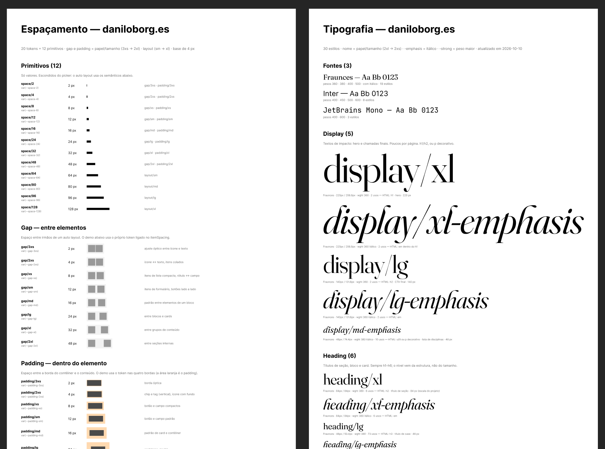

<h1 align="center">design</h1>

<p align="center"><strong>Estilos de texto e variáveis de espaçamento semânticos, no Figma e no código, sempre em sincronia.</strong><br>
Um plugin do Claude Code que renomeia <code>Text 14</code> para <code>body/md</code>, <code>item spacing/14_01</code> para <code>gap/md</code> e confere se o seu CSS segue os mesmos nomes.</p>

<p align="center">
  <a href="https://github.com/daniloborges/design-skills/actions/workflows/check.yml"></a>
  <a href="LICENSE"></a>
</p>

<p align="center">
  <a href="#por-que">Por quê</a> ·
  <a href="#instalar">Instalar</a> ·
  <a href="#uso">Uso</a> ·
  <a href="#requisitos">Requisitos</a> ·
  <a href="CHANGELOG.md">Changelog</a> ·
  <a href="CONTRIBUTING.md">Contribuir</a>
</p>

<p align="center"></p>

## Por quê

Arquivos de design saem do controle. Estilos de texto ganham nomes pela aparência (`Fraunces/Light wght 380`, `Text 14`), variáveis de espaçamento vêm de importações (`14_01`, `341_69`) e o código carrega um terceiro conjunto de nomes. Ninguém sabe qual estilo um título deve usar, nem se o código ainda corresponde ao arquivo.

Este plugin dá o mesmo vocabulário aos dois lados: `papel/tamanho` para texto (`heading/xl`, `body/md`) e `gap/*`, `padding/*`, `layout/*` para espaçamento. Os nomes formam uma lista fechada, então um estilo novo precisa de justificativa. Os mesmos nomes viram classes CSS (`.type-heading-xl`), custom properties e tokens DTCG, e um script de lint falha o build quando o código sai da lista.

A auditoria opcional de acessibilidade cobre a legislação brasileira (LBI, Lei 10.098, CDC, ANVISA) junto com a WCAG.

## Instalar

```
/plugin marketplace add daniloborges/design-skills
/plugin install design@design-skills
```

### Outros agentes

O plugin carrega só skills (sem subagentes, hooks nem servidor MCP), então todo o conteúdo viaja. Nenhuma skill define `disable-model-invocation`, e por isso nenhuma precisa de `agents/openai.yaml`.

| Canal | Comando | Skills | Subagentes | Hooks | MCP |
|---|---|---|---|---|---|
| Claude Code | `/plugin marketplace add daniloborges/design-skills` | sim | não há | não há | não há |
| Antigravity | `agy plugin install https://github.com/daniloborges/design-skills` | sim | não há | não há | não há |
| Codex | `codex plugin marketplace add daniloborges/design-skills` | sim | não há | não há | não há |
| Copilot CLI | `copilot plugin install daniloborges/design-skills` | sim | não há | não há | não há |
| Cursor | importe o repositório como marketplace | sim | não há | não há | não há |
| Outros (`npx skills add`) | `npx skills add daniloborges/design-skills` | sim | não há | não há | não há |

Só o Claude Code e o `agy plugin validate` foram executados; Codex, Copilot CLI e Cursor foram conferidos na documentação de 14/10/2026, sem rodar o cliente.

Para instalar uma skill só, baixe o arquivo `.skill` na [página de releases](https://github.com/daniloborges/design-skills/releases).

O agente do Figma aceita um texto único, sem pastas. Crie uma skill lá e cole [`figma/tipografia-semantica-agente.md`](figma/tipografia-semantica-agente.md) ou [`figma/espacamento-semantico.md`](figma/espacamento-semantico.md). Chame com `/tipografia-semantica` e `/espacamento-semantico`.

## Uso

O plugin traz quatro skills. As três de tipografia e espaçamento seguem etapas e param antes de mudar qualquer coisa no seu arquivo.

| Skill | Serve para | Fluxo |
|---|---|---|
| `/design:tipografia-semantica-figma` | Auditar estilos de texto, renomear e consolidar em nomes `papel/tamanho` | inventário → mapa → aprovação → aplicação |
| `/design:espacamento-semantico-figma` | Organizar as variáveis de gap e padding do auto layout em `Primitives` → `Spacing` | inventário → plano → proposta → preview → aplicar → arquivar |
| `/design:tipografia-semantica-codigo` | Proteger o código contra a taxonomia de texto e gerar tokens a partir do Figma | lint, geração |
| `/design:configurar-figma-console` | Instalar, diagnosticar ou ensinar a usar a ligação com o Figma Desktop pelo figma-console MCP | modos `instalar` (sem token), `ajuda`, `token`, `auditoria` |

Chame pelo nome, por exemplo `/design:tipografia-semantica-figma`, ou peça em linguagem natural: "audite os estilos de texto deste arquivo do Figma" ou "confira src/ contra a taxonomia de tipografia". As duas skills do Figma mostram um preview ANTES × DEPOIS numa página separada e só alteram o arquivo original depois da sua aprovação.

A skill de código também roda sem o Claude:

```bash
# Lint de CSS, SCSS, JSON, HTML, JSX, Vue ou Svelte. Sai com código 1 em achado bloqueante, então serve em CI.
node skills/tipografia-semantica-codigo/scripts/checar-tipografia.mjs src/ --figma estilos.json

# Gera CSS (rem) e tokens DTCG a partir dos estilos de texto do Figma
node skills/tipografia-semantica-codigo/scripts/gerar-tokens.mjs estilos.json --out tipografia
```

Exemplo de saída do lint, num CSS com dois `font-size` em px:

```console
$ node skills/tipografia-semantica-codigo/scripts/checar-tipografia.mjs demo.css
# Tipografia — guardrail

1 arquivos · 1 tokens type-* · 0 bloqueantes · 2 alertas · 0 boas práticas

| ID | Local | Problema | Correção |
|---|---|---|---|
| VOL-01 | demo.css:1 | .type-heading-xl: font-size em px (44px) não escala com a preferência do usuário | use 2.75rem |
| VOL-01 | demo.css:2 | font-size fixo em px (11px) | use rem ou um token --type-* |
```

`estilos.json` é a saída de `figma_get_text_styles` do figma-console, ou um array de `{name, fontFamily, fontStyle, fontSize, lineHeight, letterSpacing, textCase}`.

Os nomes passam do Figma para o código assim:

| Figma | Classe CSS | Custom properties | DTCG |
|---|---|---|---|
| `heading/xl` | `.type-heading-xl` | `--type-heading-xl-*` | `type.heading.xl` |
| `heading/xl-emphasis` | `.type-heading-xl-emphasis` | `--type-heading-xl-emphasis-*` | `type.heading.xl.emphasis` |

### Limites conhecidos

- Os modos do espaçamento que ligam o arquivo original às novas variáveis (`aplicar`), arquivam as antigas (`arquivar`) e descartam um preview (`descartar`) ainda não rodaram num arquivo real. `inventario`, `plano` e `preview` já rodaram.
- O lint não resolve valores `var()` e `calc()`. Confira esses à mão.

## Requisitos

- Claude Code com suporte a plugins.
- Uma conexão com o Figma para as duas skills do Figma: [figma-console-mcp](https://github.com/southleft/figma-console-mcp) ou outro MCP que execute código da Plugin API. O [`tools/figma-run`](tools/figma-run) é um executor opcional, só para o figma-console.
- Node.js 18 ou superior para os scripts. Eles não têm dependências.

## Licença

Apache-2.0. Veja [LICENSE](LICENSE).
